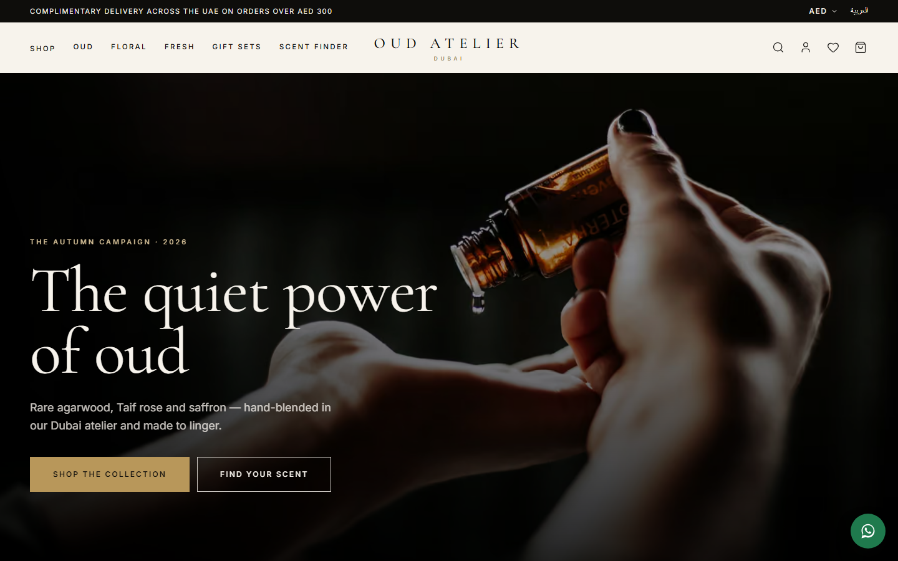
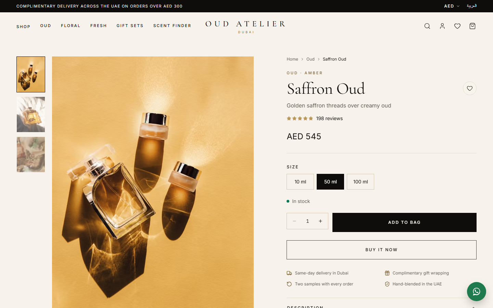
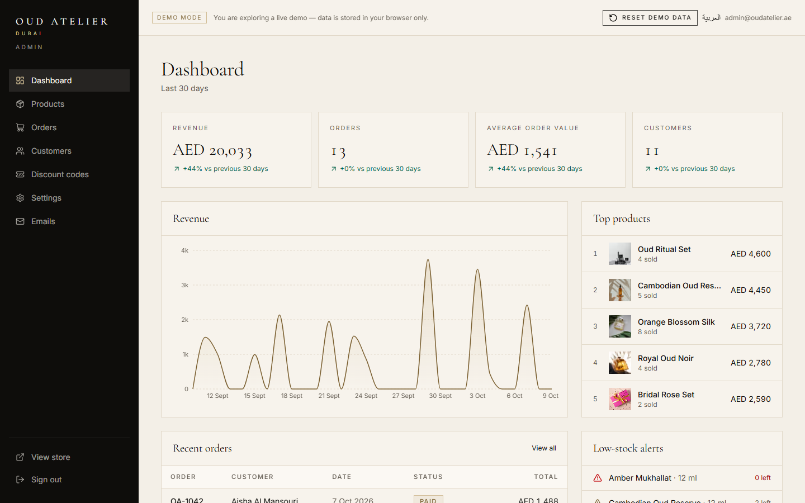

# Oud Atelier

A bilingual luxury perfume and oud boutique from Dubai — an editorial storefront in English and Arabic with a complete admin panel behind it.

**Live demo:** [store.ahmadkhajeh.com](https://store.ahmadkhajeh.com)

> This is a demo project. Products, orders and customers are fictional, payments run in test mode, and nothing is shipped. Without any configuration the store runs on seeded data stored in your browser, so you can explore every feature, including the admin panel, with one click.



## Highlights

- **Editorial storefront** — campaign hero, collections, best sellers, brand story, testimonials and an Instagram-style gallery, with restrained motion throughout.
- **English and Arabic** — full right-to-left layout, Arabic typography and localized routes, metadata and emails.
- **Three currencies** — prices in AED, USD and SAR, remembered across visits.
- **Shop and discovery** — filters by family, notes, price, size and gender, sorting, infinite loading, quick view and instant search.
- **Scent finder quiz** — five questions that recommend fragrances from the catalog.
- **Product pages** — gallery with zoom, size variants, scent pyramid, occasion and intensity, reviews and related products.
- **Cart and checkout** — slide-out bag, promo codes, free-shipping progress, gift wrapping with a message, and Stripe Checkout or a mock payment in demo mode.
- **Customer accounts** — order history with status timelines, saved addresses and a wishlist.
- **Admin panel** — revenue dashboard, product management with image upload and variants, order status updates, customers, discount codes, store settings and an email log, behind a role guard.
- **Built for search** — per-page metadata, hreflang, Open Graph images, JSON-LD structured data, sitemap and robots.
- **Accessible and fast** — keyboard and screen-reader friendly, responsive from 360px up, and lightweight on mobile.

## Screenshots

| Product page | Admin dashboard |
| --- | --- |
|  |  |

## Tech stack

- [Next.js](https://nextjs.org) (App Router) and TypeScript
- [Tailwind CSS](https://tailwindcss.com), [shadcn/ui](https://ui.shadcn.com) and [Framer Motion](https://motion.dev)
- [next-intl](https://next-intl.dev) for English and Arabic
- [Supabase](https://supabase.com) for the database, auth and storage
- [Stripe](https://stripe.com) for payments
- [Resend](https://resend.com) for transactional email
- [Zustand](https://zustand.docs.pmnd.rs), [React Hook Form](https://react-hook-form.com) and [Zod](https://zod.dev)
- Deployed on [Vercel](https://vercel.com)

## Run locally

```bash
npm install
npm run dev
```

Then open [http://localhost:3000](http://localhost:3000).

---

Demo project by [Ahmad Khajeh](https://ahmadkhajeh.com).
